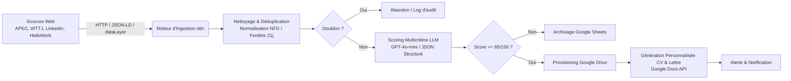

# Job Board Aggregator & Automated Application Pipeline (n8n + LLM)

Pipeline ETL (Extract, Transform, Load) de bout en bout et agent autonome d'aide à la décision conçu avec **n8n**, **JavaScript** et l'**API OpenAI (GPT-4o-mini)**. 

## 📝 Description du projet
Le système automatise la veille sur les principaux jobboards français et internationaux (APEC, Welcome to the Jungle, LinkedIn, HelloWork), gère le web scraping, applique un algorithme de déduplication strict, évalue la pertinence des opportunités par scoring multicritère structuré et génère dynamiquement des dossiers de candidature personnalisés avec CV et Lettre de motivation.

---

## 🏗️ Architecture & Data Flow



---

## ✨ Fonctionnalités Clés & Défis Techniques Relevés

### 1. Extraction asynchrone robuste (No-DOM Scraping)
Pour éviter la casse liée aux mises à jour d'UI (React/Angular), les scripts ciblent directement les balises `<script type="application/ld+json">` (Schema.org) et le `dataLayer` (GTM). Fiabilité d'extraction portée à 100%.

### 2. Algorithme de Déduplication Avancé
Création d'un système de clé unique stricte (`entreprise_titre_lieu`) pour croiser les données de 5 plateformes différentes.
* **Gestion des cabinets anonymes :** Fallback intelligent pour générer des IDs valides même si le champ entreprise est vide.
* **Fenêtre temporelle :** Algorithme comparant la date de publication avec l'historique (fenêtre glissante de 8 jours) pour détecter les remises en ligne d'offres (re-posting) sans créer de faux doublons.

### 3. Résilience et Error Handling
Implémentation de sécurités pour éviter les crashs de l'API Google Drive en cas de données manquantes ou d'hallucination du LLM (utilisation de fallbacks systématiques ex: `{{ $json.email.CORPS_MESSAGE || 'Erreur LLM' }}`).

### 4. Scoring IA Déterministe & Gestion des Exceptions (Error Handling)
- **Problématique :** Risque d'hallucination ou d'instabilité du formatage textuel des LLMs lors de l'attribution d'une note et d'une justification.
- **Solution :** Imposition d'un schéma JSON strict en sortie de `GPT-4o-mini`, adossé à des valeurs de repli systématiques (fallbacks `|| 'Valeur par défaut'`) pour éviter tout arrêt critique du flux lors des appels à l'API Google Sheets.
- **Dimensions de notation :** Adéquation du rôle (30 %), alignement de la stack technique (35 %), synergie métier/secteur (25 %), organisation et télétravail (10 %).

### 5. Génération de Documents Automatisée
Pour chaque offre inédite validée :
1. Analyse de l'offre par le node Basic Chain LLM.
2. Création d'un dossier structuré dans Google Drive.
3. Duplication de templates Google Docs (CV / Lettre).
4. Remplacement dynamique des variables générées par l'IA.

---

## 🛠️ Stack Technique & Intégrations

|Composant|Technologies & Outils|Rôle dans l'architecture|
|---|---|---|
|**Orchestration**|n8n (Webhooks, Cron triggers, Routers)|Automatisation du pipeline et orchestration des flux|
|**Scripting & Parsing**|JavaScript (ES6+), Regex avancées, DOMParser|Nettoyage de la donnée, normalisation, déduplication|
|**Intelligence Artificielle**|OpenAI API (GPT-4o-mini, Prompting structuré)|Évaluation d'adéquation et rédaction personnalisée|
|**Persistance & Documents**|Google Drive API, Google Docs API, Google Sheets API|Stockage, historisation et génération de templates|

---

## 📊 Métriques de Performance en Production

- **Volume traité :** **+300 offres uniques analysées par mois**.
- **Précision de déduplication :** **97 %** d'exactitude (taux de doublons résiduels < 3 %).
- **Gain d'efficacité opérationnelle :** **~85 % de réduction du temps** consacré au sourcing manuel et à l'adaptation des candidatures.
- **Robustesse de service :** **0 panne liée aux sélecteurs d'affichage**, assurée par la collecte via métadonnées.

---

## 📂 Structure du Répertoire

```
├── workflows/
│   └── job_aggregator_pipeline.json    # Export assaini et anonymisé du workflow n8n
├── scripts/
│   ├── deduplication.js                # Algorithmes de normalisation et création d'IDs uniques
│   └── metadata_extractor.js           # Scripts de parsing JSON-LD et regex dataLayer
├── prompts/
│   ├── scoring_prompt.md               # Prompt système pour l'évaluation multicritère
│   └── document_generation_prompt.md   # Prompt de contextualisation pour CV et lettre
└── data_sample/
    ├── raw_sample.json                 # Exemple de données brutes extraites (anonymisées)
    └── scored_output_sample.json       # Exemple d'évaluation produite par le LLM
```
